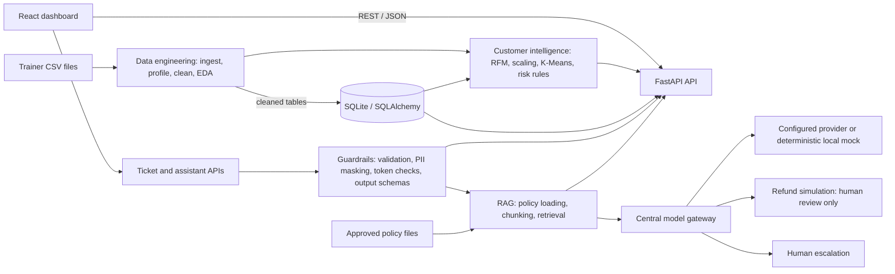

# ShopSense AI

**A modular retail analytics and guarded customer support capstone**

ShopSense AI combines data quality workflows, customer segmentation, ticket intelligence, and policy-grounded support in a local full-stack application. It is designed as an academic foundation that can be connected to trainer-supplied retail datasets and approved policies.

> **Data notice:** No trainer customer, order, or ticket dataset is included. The Markdown policies in `policies/` are synthetic demonstrations. No business metrics, customer segments, ticket accuracy, or operational outcomes are claimed from real data.

## Business problem

Retail teams often manage customer, order, and support data across separate tools. Inconsistent records make analysis difficult, while support automation must protect personal information and avoid inventing policy or transaction outcomes. ShopSense AI provides a single modular demonstration of those workflows while retaining human review for sensitive decisions.

## Objectives

- Ingest, profile, clean, validate, and explore supplied CSV data without overwriting raw files.
- Build reproducible RFM features and evaluate K-Means customer groupings.
- Process support tickets through validation, PII masking, classification, priority, and routing rules.
- Retrieve policy passages through a RAG pipeline, with all model-facing requests passing a guardrail gateway.
- Provide a React dashboard and documented local setup for review and demonstration.

## Architecture



The four academic modules are **Part A Data Engineering**, **Part B Customer Intelligence**, **Part C AI Guardrails**, and **Part D RAG Assistant**. The React dashboard and FastAPI routing integrate them. See [architecture](docs/architecture.md) for data flow details.

## Technology stack

- **Backend:** Python, FastAPI, Pydantic, SQLAlchemy, SQLite.
- **Data and machine learning:** Pandas, NumPy, Matplotlib, Seaborn, scikit-learn, joblib.
- **Support AI:** configurable PII patterns and token counting; deterministic mock fallback; optional OpenAI-compatible provider.
- **Retrieval:** local hash-vector lexical similarity and SQLite fallback; optional LangChain text splitting and Chroma persistence.
- **Frontend:** React, Vite, React Router, Recharts, Tailwind CSS, Lucide.
- **Quality:** pytest, Vitest, React Testing Library.

## Module features

### Part A — Data Engineering

Schema-aware CSV discovery; row/column profiling; missing, duplicate, category, numeric, and date summaries; configurable non-destructive cleaning; cleaning audit records; EDA charts; SQLite table creation and validation. Raw input files are preserved. See [data dictionary](docs/data_dictionary.md) and [methodology](docs/methodology.md).

### Part B — Customer Intelligence

Completed-order RFM calculation, configurable reference date, feature scaling, K-Means evaluation for K=2–8, silhouette/inertia reporting, cluster interpretation from cluster profiles, and transparent inactivity-based risk rules. The risk measure is a heuristic, not supervised churn prediction.

### Part C — AI Guardrails

Input checks, configurable token limits, PII masking, zero-shot/few-shot classification schemas, priority and team routing, model gateway enforcement, and safe response metadata. Fraud and payment concerns are directed to human review. No classification accuracy is claimed without labeled evaluation data.

### Part D — RAG Assistant

Policy loading, chunking, configurable retrieval, citations, guarded response generation, conversation storage, escalation, and refund review simulation. Refund requests do not call order/payment services and are not executed. Checked-in policies are fictional demonstrations and must be replaced with authorized current policies before any operational use.

## Repository layout

```text
backend/app/             FastAPI entrypoint and modular backend code
backend/tests/           Backend health test
datasets/raw/            Trainer-provided source CSVs (not included)
datasets/processed/      Derived cleaned CSVs (generated locally)
docs/                    Architecture, methodology, setup, QA, and submission docs
frontend/                React dashboard and preserved FreshKart demo
notebooks/               Data exploration and segmentation notebooks
outputs/                 Local reports, visualizations, models, and indexes (ignored)
policies/                Synthetic demonstration policies
tests/                   Data, ML, guardrail, RAG, API, and integration tests
requirements.txt         Core Python requirements
requirements-optional.txt Optional notebook and retrieval integrations
```

## Installation and configuration

Requirements: Python 3.10+ (developed with 3.11), Node.js 20.19+ or 22.12+, and npm. In PowerShell from the repository root:

```powershell
py -3 -m venv .venv
.\.venv\Scripts\Activate.ps1
python -m pip install --upgrade pip
pip install -r requirements.txt
Copy-Item .env.example .env
```

Optional integrations (Jupyter, `tiktoken`, LangChain splitters, Chroma) are installed separately:

```powershell
pip install -r requirements-optional.txt
```

Set configuration in the local ignored `.env`. Keep real credentials out of source control. Vite loads the root `.env`; browser-exposed settings must use the `VITE_` prefix. The dashboard API base defaults to `http://127.0.0.1:8000`. Optional OpenAI-compatible integrations require valid authorized credentials and are not enabled by default.

Place authorized `customers.csv`, `orders.csv`, and `tickets.csv` files in `datasets/raw/`. The data pipeline reports missing inputs rather than generating substitutes. Policies are read from `policies/` by default.

## Start the backend

From the repository root, in terminal 1:

```powershell
cd backend
..\.venv\Scripts\python.exe -m uvicorn main:app --reload
```

API base URL: `http://127.0.0.1:8000`  
Interactive OpenAPI docs: `http://127.0.0.1:8000/docs`  
Health: `http://127.0.0.1:8000/api/health`

## Start the frontend

In terminal 2, from the repository root:

```powershell
cd frontend
npm install
npm run dev
```

Open the Vite URL shown in the terminal (normally `http://localhost:5173`). The React dashboard contains Overview, Data Quality, Customer Intelligence, Support Intelligence, AI Assistant, and Settings pages. The preserved FreshKart storefront is served at `/marketplace.html`.

## API overview

| Area | Routes |
|---|---|
| System/data | `GET /api/health`, `/api/datasets/availability`, `/api/data/profiling`, `/api/data/eda`; `POST /api/data/cleaning` |
| Database | `GET /api/database/statistics` |
| Customers | `GET /api/customers/rfm`, `/segments`, `/churn-risk`, `/model-evaluation`, `/summary` |
| Tickets | `POST /api/tickets/validate`, `/classify`, `/process`; `GET /api/tickets/summary` |
| Assistant | `GET /api/assistant/health`; `POST /api/assistant/retrieve`, `/chat`, `/refund`, `/escalate` |

Use `/docs` for the live OpenAPI schema when the backend is running. Responses avoid unnecessary customer identifiers and raw ticket text.

## Testing and verification

From the repository root:

```powershell
python -m pytest backend/tests tests -q
python -m compileall -q backend tests
python -m pip check
```

From `frontend/`:

```powershell
npm test -- --reporter=dot
npm run build
npm ls --depth=0
```

The integration test uses temporary controlled CSV and policy fixtures, not project datasets. It checks connected route handlers, data persistence, downstream modules, PII masking, OpenAPI routes, and CORS configuration. Current test and environment results are recorded in [testing summary](docs/testing_summary.md); coverage limits are explained in the [integration audit](docs/integration_audit.md).

## Screenshots

No screenshots are included because no genuine capture was produced for this submission. Capture the application locally using the checklist in [screenshot evidence](docs/screenshot_checklist.md). Do not use test fixtures as if they were real customer data.

## Limitations

- Trainer datasets are missing, so actual row counts, data-quality findings, customer segments, churn risk, ticket classifications, and business outcomes remain pending.
- Test fixtures verify code behavior only and must not be reported as business findings.
- The default ticket model is deterministic mock mode. Local hash-vector retrieval is lexical, not semantic.
- Chroma, LangChain splitting, token-aware counting, and remote embeddings are optional and require explicit installation/configuration.
- Refund is a review simulation without live order/payment integration; sensitive issues require human handling.
- HTTP-level integration and live browser interaction were not verified in the previous QA run due to environment stalls/timeouts. See testing summary.
- Authentication, authorization, production deployment, and real retailer policy validation are outside this academic foundation.

## Future enhancements

Connect the authorized trainer dataset; establish data quality acceptance rules; evaluate clustering with domain review; add labeled ticket evaluation; configure and evaluate an approved model provider; add real semantic retrieval evaluation; integrate authenticated order lookup and refund workflows behind approvals; add role-based access, audit retention controls, deployment automation, and live HTTP/browser end-to-end tests.

## Academic submission

This repository demonstrates four related academic modules. Start with [project overview](docs/project_overview.md), review [methodology](docs/methodology.md), and use the [academic requirement mapping](docs/academic_evaluation_mapping.md) to locate implementation and test evidence. A timed talk track is in [presentation demo](docs/presentation_demo.md); beginner-friendly viva preparation is in [viva preparation](docs/viva_preparation.md). The current Git history is empty and the worktree contains uncommitted files. See the branch plan in the evaluation mapping; no remote was configured and nothing has been pushed.

Use the [final submission checklist](docs/final_submission_checklist.md) to review verified tests, missing trainer data, and screenshot status before handing the project in.
