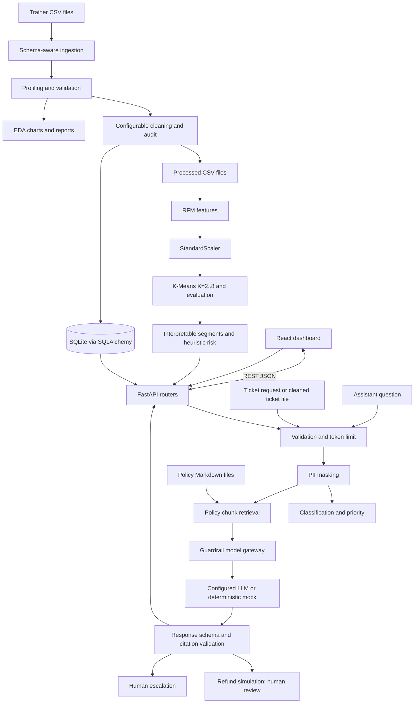

# ShopSense AI architecture

## System view

## Component responsibilities

- **FastAPI (`backend/app/main.py`, `backend/app/api/`)** registers system, data, customer, ticket, and assistant endpoints. CORS is scoped to the two local Vite origins.
- **Data engine (`backend/app/data_engine/`)** discovers and profiles CSV schemas, applies configured transformations without editing raw files, creates audit/report artifacts, and prepares cleaned files for the database and downstream modules.
- **Database (`backend/app/database/`)** defines SQLAlchemy models, SQLite connection setup, repository operations, constraints, and indexes. Table and column mappings depend on the discovered source schema.
- **Customer intelligence (`backend/app/customer_intelligence/`)** maps available customer/order columns, filters completed orders, calculates RFM, scales model features, evaluates K-Means candidates, names clusters from observed profiles, and assigns transparent inactivity risk rules.
- **Guardrails (`backend/app/guardrails/`)** validates input, masks personal data, checks a configurable token budget, constructs safe prompts, mediates model calls, validates structured results, and routes cases.
- **RAG (`backend/app/rag/`)** loads Markdown policies, creates source-referenced chunks, embeds/searches them, routes generation through the guardrail gateway, validates answers, and handles safe memory, simulated refund review, and escalation.
- **React/Vite (`frontend/src/`)** presents six dashboard pages and calls the API through one service module. The legacy storefront is a separate HTML entry.

## Primary data flow

Raw CSVs stay in `datasets/raw/`. Phase A creates cleaned files under `datasets/processed/`, reports/audits under `outputs/reports/`, charts under `outputs/visualizations/`, and the configured SQLite database. Phase B consumes processed customer and order data. Ticket processing consumes the processed ticket file or validated user input. Assistant retrieval uses Markdown policies, not customer records. Generated outputs and local databases are ignored by Git.

## Assistant request flow

Raw text is validated, masked, and checked against configured limits before it is used for retrieval or model generation. Retrieval returns policy references and similarity metadata. The model gateway validates generated output and citations. Missing or weak context results in cautious behavior. Refund requests remain in human review; escalation is explicit. The default local embedding mode uses deterministic hash vectors and lexical similarity; it is not semantic search.

## Trust boundaries and deployment

The backend is not an authenticated production service. Local CORS configuration is not an access-control system. External model and embedding credentials belong only in a server-side ignored `.env`; never use private credentials in `VITE_` variables. Synthetic policies must be replaced with approved, current policies before operational use. See [integration audit](integration_audit.md).
